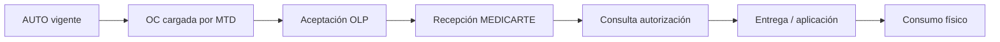
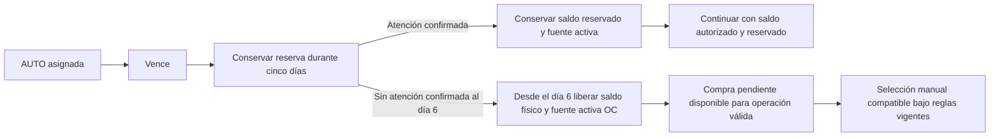
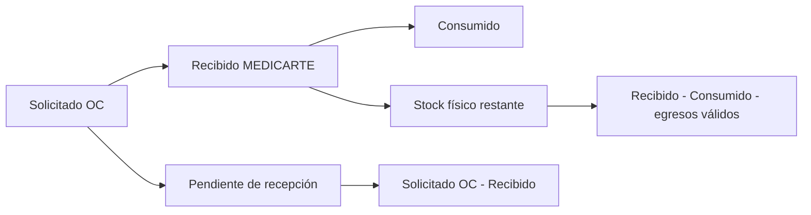

# ADR-043 — Autorización → OC → Recepción → Consumo → Reasignación

Estado: documentación de AS-IS, decisiones de negocio y TO-BE
Fecha: 2026-09-24
Actualización operativa: 2026-11-04

## Propósito y alcance

Este documento separa lo demostrado por el código (`AS-IS`), las decisiones de
negocio confirmadas (`DECISIÓN DE NEGOCIO`) y el comportamiento que deberá
implementarse posteriormente (`TO-BE`). Las actualizaciones registran cambios
de comportamiento y esquema; el catálogo generado documenta las columnas e
índices resultantes de Drizzle.

La trazabilidad operativa que debe conservarse es:



El flujo objetivo cuando vence una AUTO es:



El modelo de cantidades es:



## Identidad de una AUTO y recargas

### AS-IS confirmado

La identidad persistida de `authorization_items` es la combinación:

```text
(numero_autorizacion, codigo_medicamento)
```

El importador calcula `authorization_key` como:

```text
numero_autorizacion + "|" + codigo_comercial
```

La escritura está en `apps/api/src/bulk-imports/bulk-import.repository.ts`, en
`upsertAuthorizationInTx()`. La inserción usa `ON CONFLICT
(numero_autorizacion, codigo_medicamento) DO NOTHING`; después bloquea la fila
existente con `FOR UPDATE`, compara el payload normalizado y decide `NO_OP` o
`UPDATE`. El `UPDATE` incrementa `version`, actualiza `updated_at`,
`updated_by`, `last_load_id`, `source_data`, estado, vigencia derivada y demás
campos controlados por la carga.

La restricción de identidad y el índice único se originan en las migraciones de
autorizaciones, y la evolución de la identidad de demanda/lineage está en
`0058_authorization_based_projected_demand.sql`,
`0065_authorization_demand_identity.sql` y
`0067_purchase_order_authorization_sources.sql`. `authorization_key` no es una
segunda identidad independiente: es la clave operacional derivada de la misma
pareja autorización-producto.

Si el contenido semántico no cambia, la recarga es `NO_OP` y no cambia
`version`, `updated_at` ni `last_load_id`. Si cambia, el importador intenta
actualizar la AUTO, pero actualmente bloquea la operación cuando existe una OC
no cancelada ni rechazada asociada por
`purchase_order_authorization_sources`. No hay versionado histórico completo de
cada payload: existe `version` en el registro vivo y auditoría de la operación,
pero no una tabla de versiones de atributos de AUTO.

### DECISIÓN DE NEGOCIO

La identidad estable de una AUTO debe ser `authorization_key`, conforme a la
identidad que el código confirme: autorización (`numero_autorizacion`) más
código comercial (`codigo_medicamento`/`CODIGO_COMERCIAL`). Una recarga con la
misma clave debe actualizar cantidad autorizada, `FECHA_FINAL_VIGENCIA`, estado y
los demás atributos vivos actualizables.

La actualización de la AUTO no debe reconstruir ni modificar una OC histórica.
La relación `purchase_order_authorization_sources` conserva la clave, producto,
cantidad y versión que justificaron la OC cuando fue creada.

### TO-BE

La actualización deberá ser posible sin reescribir la demanda histórica ya
comprometida en una OC. El estado vivo de `authorization_items` y el snapshot de
`purchase_order_authorization_sources` deben tratarse como dos tiempos distintos:

- **AUTO actual:** cantidad, vigencia, estado y atributos vigentes.
- **Demanda histórica de OC:** clave, producto, cantidad, versión y momento
  utilizados al crear la OC.

Ejemplo: si AUTO-X pasa de cantidad 1 a 2 y su vencimiento cambia de
2026-10-10 a 2026-10-20, se actualiza `authorization_items`; una OC ya creada
conserva su snapshot original.

## OC, disponibilidad y asignación

### AS-IS confirmado

La consolidación materializa `projected_demand_lines` y `demand_sources`. La OC
se crea desde esa demanda. `purchase_order_authorization_sources` conserva la
relación OC + AUTO + código comercial + cantidad snapshot y es la evidencia que
usa el fulfillment para hacer visible una autorización a MEDICARTE.

La ruta moderna de Disponibilidad usa `inventory_authorization_allocations`.
`InventoryAvailabilityRepository` calcula disponibilidad por OC/producto/punto,
considera recepciones, consumos y asignaciones, y permite cargar asignaciones por
UI o XLSX. `AuthorizationFulfillmentRepository.ensureAutomaticAllocation()`
puede crear una allocation al consultar/atender una autorización cuando no hay
una activa; obtiene la demanda desde `purchase_order_authorization_sources` y
resuelve el punto mediante la programación activa más reciente.

Por tanto, el código actual sí contiene el segundo paso conceptual:

```text
OC/AUTO → Disponibilidad → inventory_authorization_allocations → fulfillment
```

### DECISIÓN DE NEGOCIO

MTD continuará cargando la OC con:

```text
OC + CLAVE_AUTORIZACION + CODIGO_COMERCIAL + CANTIDAD
```

La relación AUTO → OC representa la demanda lógica original y no debe eliminarse.
La asignación lógica nace con el archivo de OC cargado por MTD. Disponibilidad no
debe cambiar qué AUTO originó comercialmente la OC ni reescribir su snapshot.
Además, puede reservar stock físico libre para una AUTO elegible según
[BR-AUTO-DISP-001](../requirements/BR-AUTO-DISP-001-asignacion-automatica-disponibilidad.md).
Esa reserva puede tomar producto de otra OC compatible y no modifica la compra.

El flujo objetivo es:

```text
MTD define OC + AUTO + producto + cantidad
OLP acepta la OC y registra fecha de entrega
MEDICARTE confirma cuánto recibió físicamente
Consulta autorización entrega/aplica solo lo físicamente disponible
```

### TO-BE

`purchase_order_authorization_sources` permanece como relación histórica
fundamental. El módulo Disponibilidad puede permanecer por compatibilidad o
consulta y puede crear reservas físicas automáticas conforme a
[BR-AUTO-DISP-001](../requirements/BR-AUTO-DISP-001-asignacion-automatica-disponibilidad.md).
La relación comercial AUTO → OC y su snapshot permanecen intactos.

## Recepción y existencia física

### AS-IS confirmado

Hay dos rutas distintas:

1. La ruta histórica `deliveries → receipts → receipt_lines` confirma una
   recepción y llama `ReceiptRepository` a
   `InventoryRepository.recordConfirmedReceipt()`. Esa escritura crea/reutiliza
   `inventory_lots` y registra un movimiento `RECEIPT` en
   `inventory_movements`.
2. La ruta moderna directa de OC (`purchase_order_receipts` y
   `purchase_order_receipt_lines`) permite a MEDICARTE enviar solo
   `receivedQuantity`. El propio código de `createPurchaseOrderReceipt()` indica
   que no llama a `recordConfirmedPurchaseOrderReceipt()` porque esa ruta
   pertenece al ledger legacy basado en lotes. Esta ruta guarda evidencia de
   cantidad y actualiza el estado de la OC, pero no crea lote ni movimiento de
   inventario.

La consulta de Disponibilidad suma eventos `RECEIPT` del ledger para determinar
`received_quantity` y resta `authorization_fulfillment_lines` para obtener lo
consumido. Por ello la recepción directa quantity-only puede quedar fuera del
inventario físico que usa fulfillment.

### DECISIÓN DE NEGOCIO

Una OC no crea stock consumible. La cantidad física máxima consumible es:

```text
stock físico restante = MEDICARTE_RECIBIDO - CONSUMIDO - otros egresos físicos válidos
```

Con OC solicitada 10 y recibida 5: solicitado = 10, recibido = 5, pendiente de
recepción = 5 y máximo consumible = 5. Nunca se debe consumir la cantidad
solicitada por el solo hecho de existir la OC.

### TO-BE

La recepción confirmada por MEDICARTE debe alimentar la misma autoridad de
existencia física que consulta fulfillment, conservando cantidad, producto, OC,
punto y, cuando aplique, lote/vencimiento. El contrato quantity-only debe
integrarse de forma explícita con esa autoridad o quedar claramente fuera del
flujo de consumo hasta que exista evidencia física compatible.

## Escasez, vencimiento y reasignación

### DECISIÓN VIGENTE

Aplicar [BR-AUTO-EXP-001](../requirements/BR-AUTO-EXP-001-gracia-continuidad-atencion.md).
La fecha final es inclusiva; los días 1 a 5 posteriores permiten entrega o
aplicación con las demás validaciones. Desde el día 6, una AUTO sin atención
confirmada no puede iniciar atención y libera reserva pendiente y fuentes
activas de OC sin esperar al cierre del mes. Con atención confirmada, conserva
el saldo ya reservado y la fuente activa para permitir continuidad cuantificada.
La expiración no elimina la relación histórica entre la AUTO y la OC.

### GRACIA DE CINCO DÍAS

El día de vencimiento inicia el período de gracia.

Durante los días 1 a 5 posteriores al vencimiento,
la allocation activa permanece asociada a la AUTO.

Durante esta gracia se permite entrega o aplicación hasta los saldos
autorizados y reservados, si se cumplen las demás validaciones. Una recepción
real puede crear una reserva vinculada a una fuente activa.

Si la allocation no tiene consumo previo, puede
transferirse mediante una reasignación explícita y
atómica hacia una AUTO_DESTINO válida.

A partir del día 6, cuando no existe atención confirmada, si:

FECHA_FINAL_VIGENCIA < HOY - 5

el worker libera automáticamente el saldo:

allocated_quantity
- consumed_quantity
- released_quantity

La allocation histórica no se elimina.

El worker libera también las fuentes activas de OC sin esperar al cierre del
mes. La fila histórica y source_quantity_snapshot permanecen intactos; el
actor automático queda registrado como SYSTEM. Si existe atención confirmada,
el worker no libera la reserva ni el vínculo activo. Según la regla aprobada
posteriormente en BR-AUTO-EXP-001, una recepción física posterior de esa misma
OC activa puede crear un top-up dentro de los límites del snapshot comercial,
saldo autorizado y pool recibido; no reactiva una fuente liberada.
La liberación no modifica cantidades solicitadas,
recibidas ni consumidas. La compra pendiente puede
asignarse manualmente a una AUTO elegible mediante
PURCHASE_ORDERS_V3 con AUTO_ORIGEN vacía.
Si la misma AUTO se renueva después de esta liberación, MTD puede elegirla
manualmente como `AUTO_DESTINO` y seleccionar la misma línea de OC pendiente.
El vínculo anterior conserva su `id`, cantidad y fecha de liberación; la nueva
asignación crea otra fila activa con `id` propio. La renovación no recupera
automáticamente capacidad comprometida a otra AUTO.

El importador valida vigencia, producto, punto y capacidad pendiente de la línea
antes de crear el nuevo vínculo. El worker toma locks `NOWAIT` por AUTO y cede
ante una edición manual concurrente; reintenta esa AUTO en el siguiente barrido.

El cambio de clave requiere despliegue coordinado: detener escrituras de OC,
aplicar `0103a_release_backfill_guard_window`, `0104`,
`0105_purchase_order_source_history` y `0106_restore_released_source_guard`
en una sola transacción de Drizzle, desplegar la API y el worker actualizados y
entonces reanudar escrituras. `0103a` suspende solo el trigger que protege las
fuentes liberadas para permitir el backfill de `released_by_type` en `0104`;
`0106` lo reactiva antes del commit. Si la migración falla, la transacción
revierte ambos cambios del trigger y el backfill. En bases que ya aplicaron
`0104` y `0105`, solo se ejecuta `0106`, que deja el trigger habilitado.
La reversión lógica
de `0105` exige retirar o reconciliar primero cualquier segunda fila histórica
de la misma pareja línea–AUTO; no se puede restaurar la clave compuesta sobre
esas filas sin perder evidencia.

La migración `0105_purchase_order_source_history` da a cada fila de fuente un
`id` propio y cambia la unicidad a un índice parcial sobre
`(purchase_order_line_id, authorization_item_id)` para filas activas
(`released_at IS NULL`). Así se conserva la fila liberada y se puede insertar
una fuente activa nueva para esa misma pareja. Los totales operativos cuentan
solo fuentes activas; las consultas históricas eligen una fila por pareja para
no duplicar cantidades.

### REASIGNACIÓN EXPLÍCITA

La reasignación se realiza mediante la plantilla de
órdenes de compra usando AUTO_ORIGEN, AUTO_DESTINO,
OC, CODIGO_PRODUCTO y CANTIDAD.

AUTO_DESTINO debe:

- estar habilitada;
- estar dentro de la ventana operacional;
- no estar vencida;
- no estar fuera de Hoy + 30;
- no estar cerrada;
- no tener otra OC o reserva activa incompatible;
- tener el mismo producto;
- tener la misma cantidad completa;
- resolver el mismo punto operacional.

AUTO_ORIGEN puede estar vencida dentro de la gracia,
pero no puede tener producto consumido ni una
entrega/aplicación confirmada.

La transferencia de inventory_authorization_allocations
y purchase_order_authorization_sources debe ocurrir
en la misma transacción.

Si falla cualquier validación, AUTO_ORIGEN conserva
íntegramente su reserva.

### EXPORTAR AUTO PARA OC

El exportable de candidatos para nueva OC incluye
únicamente AUTO operables dentro de la ventana vigente.

EXPIRED, OUTSIDE_HORIZON e INVALID_DATE no son
candidatas para una nueva OC.

Una AUTO puede distribuir su cantidad autorizada entre múltiples OC activas mientras exista saldo pendiente de compra.

La cobertura para compra se calcula como:

CANTIDAD_CUBIERTA = MAX(
  CANTIDAD_COMPROMETIDA_EN_OC_ACTIVAS,
  CANTIDAD_ENTREGADA_APLICADA + CANTIDAD_FISICA_ASIGNADA_PENDIENTE
)

SALDO_PARA_OC = MAX(
  CANTIDAD_AUTORIZADA - CANTIDAD_CUBIERTA,
  0
)

La cantidad de cada fila debe cumplir:

0 < CANTIDAD_FILA <= SALDO_PARA_OC

La parcialidad aplica a la asignación de compra. La reasignación explícita AUTO_ORIGEN -> AUTO_DESTINO conserva la regla de cantidad completa 1:1.

## Entrega/aplicación y cantidades

### AS-IS confirmado

La entrega/aplicación desde Consulta autorización usa
`AuthorizationFulfillmentRepository`. `ensureAutomaticAllocation()` consulta el
snapshot de OC y puede crear `inventory_authorization_allocations`; `fulfill()`
bloquea las allocations, comprueba existencia física en `inventory_lots`,
selecciona lotes FEFO, crea `authorization_fulfillment_lines` y escribe
movimientos negativos `FULFILLMENT_APPLICATION` o `FULFILLMENT_DELIVERY`.

La ruta actual exige que exista inventario físico suficiente para la allocation,
pero su coherencia con recepción directa quantity-only es incompleta por el GAP
anterior. MEDICARTE no tiene un `inventory.allocate` separado en esta ruta; la
allocation se crea dentro de fulfillment o por el módulo Disponibilidad.

### DECISIÓN DE NEGOCIO

Consulta autorización solo puede consumir producto efectivamente recibido por
MEDICARTE, del código comercial correcto, de una OC compatible y no consumido
previamente. Una unidad ya entregada/aplicada nunca puede reasignarse.

## Invariantes objetivo

- `OC_SOLICITADO >= MEDICARTE_RECIBIDO`.
- `MEDICARTE_RECIBIDO >= CONSUMIDO`.
- Nunca `CONSUMIDO > RECIBIDO`.
- Actualizar una AUTO no modifica el snapshot histórico de una OC.
- La evidencia AUTO → OC permanece cuando la AUTO vence; la fuente activa se
  conserva tras el día 5 si existe atención confirmada y se libera desde ese día
  si no existe atención, sin esperar al fin de mes.
- Una unidad reservada y no consumida solo puede pasar a otra AUTO mediante reasignación explícita y atómica.
- Una unidad consumida no puede reasignarse.
- El vencimiento conserva la reserva durante cinco días; desde el día 6 sin atención confirmada libera el saldo no consumido y la fuente activa OC. Con atención confirmada se conservan ambas para continuidad cuantificada, manteniendo su evidencia histórica.

## Modelo temporal y trazabilidad mínima

| Hecho | Información que debe conservarse |
| --- | --- |
| AUTO actual | cantidad, vigencia, estado y atributos vivos |
| Demanda histórica de OC | clave, producto, cantidad snapshot, versión y fecha de creación |
| Recepción | OC, producto, punto, cantidad realmente recibida y evidencia física disponible |
| Consumo | AUTO atendida, OC, lote si aplica, cantidad, fecha y usuario |
| Reasignación | AUTO original, motivo, AUTO sustituta, producto, cantidad, fecha y usuario/proceso |

No se debe borrar información histórica para representar vencimiento, liberación o
reasignación.

## Known gaps / diferencias entre implementación y modelo objetivo

| Área | Evidencia AS-IS | Diferencia documentada |
| --- | --- | --- |
| Actualización de AUTO con OC existente | `upsertAuthorizationInTx()` bloquea cambios si hay OC no cancelada/rechazada | TO-BE debe actualizar la AUTO viva sin mutar el snapshot de OC |
| Recepción quantity-only | `createPurchaseOrderReceipt()` solo persiste `purchase_order_receipt_lines` y no llama al ledger legacy | La recepción directa no alimenta de forma demostrada `inventory_movements`/`inventory_lots` usados por fulfillment |
| Disponibilidad | `InventoryAvailabilityRepository` conserva cargas UI/XLSX y además asigna stock físico libre a AUTOs vigentes, compatibles y priorizadas por vencimiento | La reserva se registra por OC/producto/punto sin cambiar la relación comercial AUTO–OC |
| Fulfillment automático | `ensureAutomaticAllocation()` crea allocations desde el snapshot de OC | El contrato backend actual todavía materializa asignación al atender; debe alinearse con la asignación lógica nacida en la OC |
| Recepción histórica | `recordConfirmedReceipt()` sí crea lotes y movimientos `RECEIPT` | Conviven dos arquitecturas y la quantity-only no tiene la misma evidencia física |
| Retención/reasignación | `reconcileIneligibleTx()` no libera reservas; el worker libera allocation y fuente activa desde el día 6 solo sin atención confirmada. La transferencia a una AUTO_DESTINO vive en `PurchaseOrderImportService` | La continuidad parcial conserva el saldo existente; BR-AUTO-EXP-001 permite después un top-up físico solo por recepción de la misma OC y fuente aún activa |
| Concurrencia de consumo | Fulfillment usa transacción, locks de autorización/allocation/punto y valida lotes | El TO-BE exige además una reserva/consumo atómico que no elija AUTO propietaria por anticipado en escasez |

Los GAPs de recepción directa en el ledger legacy y de consumo que aparecen en la
tabla siguen vigentes. La asignación automática de stock libre descrita en
[BR-AUTO-DISP-001](../requirements/BR-AUTO-DISP-001-asignacion-automatica-disponibilidad.md)
sí crea reservas físicas trazables, sin resolver por sí sola esos otros GAPs.

## Precedencia del punto programado

### DECISIÓN VIGENTE

Para crear o ampliar una relación AUTO -> OC, el punto operacional de
`AUTO_DESTINO` se resuelve con la siguiente precedencia:

1. Programación activa en `patient_schedules`.
2. Si no existe programación activa, punto habitual activo del paciente en
   `patient_default_dispensing_points`.
3. Si tampoco existe punto habitual, se conserva el resolver por
   `tariff_annex_products` y `product_delivery_point_mappings`.

Una programación activa corresponde a `SCHEDULED` o `RESCHEDULED`.

Si una misma AUTO tiene programaciones activas en más de un punto distinto,
la operación se rechaza por ambigüedad. No se selecciona un punto
arbitrariamente.

`purchase_order_lines.dispensing_point_id` continúa siendo el snapshot
operacional e histórico de la OC. Los cambios posteriores en la programación
del paciente no modifican órdenes de compra ya creadas.

Un punto como BUCARAMANGA puede recibir cualquier producto cuando la
AUTO_DESTINO tenga una programación activa en ese punto. No se crean mappings
producto por producto para BUCARAMANGA.

`product_delivery_point_mappings` permanece como fallback para autorizaciones
sin programación activa.


## 2026-10-15 — Corrección de regresión en asignación desde OC

- Para una OC existente y `CLAVE_AUTORIZACION_ORIGEN` vacía,
  la plantilla V2/V3 reserva existencias recibidas del producto
  en el punto correspondiente. No crea cantidades de compra.
- `purchase_order_lines.requested_quantity` permanece intacto.
- `purchase_order_authorization_sources` no se modifica para
  representar una nueva reserva física.
- La materialización se registra mediante
  `inventory_allocation_batches` e
  `inventory_authorization_allocations`.
- Una OC nueva conserva su creación comercial.
- Una reasignación con origen explícito conserva el
  comportamiento 1:1 sin modificar cantidades compradas.
- El evento `PURCHASE_ORDER_AVAILABLE_ASSIGNED` distingue
  la reserva física de una ampliación de compra.
- El evento incluye actor, correlación, OC, producto, punto,
  autorización destino, cantidad y lote de asignación.
- MEDICARTE puede consultar y consumir reservas físicas
  aunque no se cree una fuente de compra nueva.
- Las líneas indebidas creadas el 15 de octubre son un
  incidente histórico de producción que requiere una
  reconciliación supervisada y auditoría independiente.


## 2026-10-16 — Consistencia de disponibilidad de OC existente (corrección local)

Implementación pendiente de pruebas finales e integración: **NO desplegada**.

- Una reserva `ASSIGN_AVAILABLE` compara dos límites en una misma transacción:
  disponibilidad `OC+producto+punto` y saldo global `OC+producto`. El mínimo
  determina la cantidad admitida. Las reservas pendientes del mismo archivo
  se descuentan de ambos límites antes de insertar.
- Para `quantity-only`, la recepción moderna persistida en
  `purchase_order_receipt_lines` es fuente válida de entrada, aunque
  `inventory_lots` e `inventory_movements` estén vacías. El modelo histórico
  sigue contando **solo entradas** `RECEIPT` válidas y no vencidas;
  además, si no existe recepción moderna para la OC/producto, la reserva
  se limita al balance FEFO utilizable del ledger legado (descontando reservas
  activas del mismo producto/punto de todas las OC).
- Los consumos se toman de `authorization_fulfillment_lines` y las reservas
  pendientes de `inventory_authorization_allocations`. No se suman dos veces
  las allocations ya consumidas. Una liberación histórica no es reserva activa.
- El lock advisory `OC_PRODUCT_ALLOCATION:<OC_UUID>:<CODIGO>` se adquiere en
  asignación UI/XLSX y en el importador hacia OC existente; también se conserva
  el lock por punto y el lock de reconciliación existente.
- La consulta de disponibilidad aplica el mismo límite global, sin dar a otro
  punto saldo de una OC ya consumido o comprometido.
- La clave numérica `numero_autorizacion` del archivo se resuelve junto al
  código comercial; también se admite `authorization_key` persistida. Se
  rechazan identidades duplicadas o ambiguas.
- Cuando la línea OC no contiene punto, se usa mapping canónico solo si es
  inequívoco. Nunca se multiplica la recepción por múltiples filas del AT.
- La ruta de asignación directa resuelve punto mediante programación activa,
  punto habitual y mapping canónico, con errores explícitos por ambigüedad.
- No se editan `requested_quantity`, `purchase_order_authorization_sources`,
  recepciones ni reservas históricas. No se liberan automáticamente AUTOs
  vencidas o administrativamente bloqueadas.

**Criterios de certificación pendientes:** pruebas unitarias,
`pnpm lint`, `pnpm --filter @authorization/api typecheck`, build, suite
de integración PostgreSQL real, concurrencia entre importador/UI y
conciliación sobre OC 9198/9218/9230, sin intervenir producción.


## 2026-11-03 — Vencimiento, liberación y reutilización de OC pendiente (regla reemplazada el 2026-11-04)

- Una AUTO vencida conserva su reserva física y la fuente activa de OC durante
  los cinco días posteriores. Entrega y aplicación quedan bloqueadas hasta
  ampliar la vigencia y superar las demás validaciones.
- Desde el día 6, el worker libera el saldo físico no consumido. Libera las
  fuentes activas de OC cuando además terminó el mes de vencimiento. La fuente
  liberada conserva `id`, cantidad snapshot, fecha y actor
  `SYSTEM`; las cantidades solicitadas, recibidas y consumidas no cambian.
- Después de una renovación, MTD puede volver a seleccionar manualmente la
  misma AUTO con `AUTO_ORIGEN` vacío para una línea de OC aún pendiente y sin
  recibir. La nueva fila activa requiere vigencia, producto, punto y capacidad
  disponibles. La renovación no restaura allocations ni recupera capacidad
  comprometida a otra AUTO.
- El importador bloquea la OC y controla capacidad por orden, producto, punto y
  línea. El worker procesa cada AUTO en una transacción y toma los locks con
  `NOWAIT`; si una edición manual sostiene un lock, revierte solo ese caso y
  lo reintenta en el siguiente barrido. La liberación, auditoría e
  invalidaciones del caso comparten transacción.
- El cambio de clave se despliega aplicando `0104`, deteniendo escrituras de
  OC, aplicando `0105_purchase_order_source_history`, desplegando API y worker
  compatibles y reanudando las escrituras después.

## 2026-11-04 — Gracia y continuidad con atención parcial confirmada

- El día de vencimiento es inclusivo. Durante los días calendario 1 a 5 se
  permite atención bajo los controles y saldos autorizados/reservados.
- Desde el día 6, el worker libera reserva física pendiente y fuentes activas
  OC únicamente cuando no existe atención confirmada, sin esperar al cierre
  del mes. Con atención confirmada conserva saldo y vínculo activo. La decisión
  aprobada después permite completar progresivamente la reserva ante una
  recepción física posterior de esa misma OC activa, dentro de los límites
  comerciales, autorizados y físicos; no revive fuentes liberadas.
- La consulta de evidencia considera fulfillment confirmado, aplicación
  histórica confirmada y consumo positivo en allocations. El saldo atendido se
  agrega con `greatest`, no sumando evidencia duplicada.
- La fecha de `authorization_dispensations` no contiene cantidad y no acredita
  por sí sola un saldo parcial. Su tratamiento requiere reconciliación; ver
  [BR-AUTO-EXP-001](../requirements/BR-AUTO-EXP-001-gracia-continuidad-atencion.md).
- La liberación, auditoría e invalidaciones permanecen dentro de la transacción.
