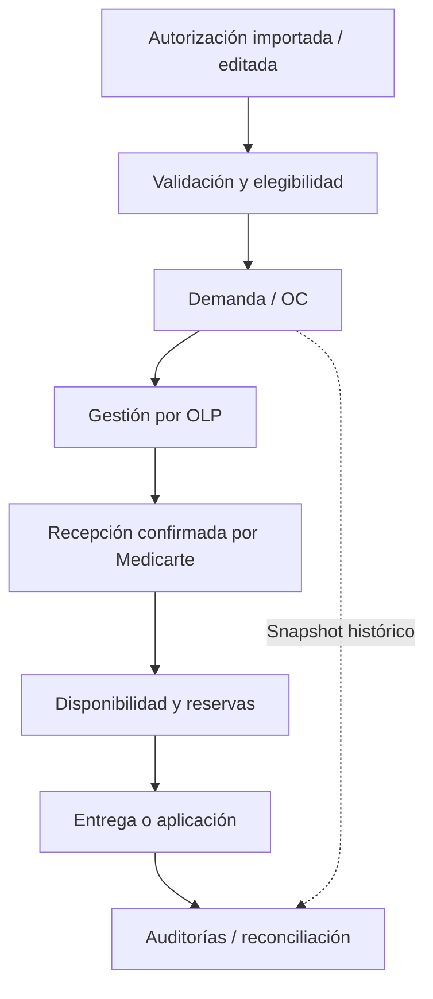

# Arquitectura operacional observada en `develop`

**Corte documental:** 2026-10-17. **Referencia:** `develop` @
`7ced5792c08faf35e673e2f1c2ca4571892ab87a`.

## 1. Mapa técnico

| Capa | Ubicación | Responsabilidad comprobable en el repositorio |
| --- | --- | --- |
| Interfaz | `apps/web/app`, `apps/web` | Rutas Next.js para módulos operativos y administrativos |
| API | `apps/api/src/app.module.ts` | Controladores, servicios y repositorios NestJS |
| Worker | `apps/worker/src` | Procesamiento asíncrono, outbox y barrido de vencimientos |
| Dominio | `packages/domain/src` | Cálculos y reglas compartidos, incluidos estados y cobertura |
| Contratos | `packages/contracts` | Validación y contratos de intercambio |
| Base de datos | `packages/database/src`, `packages/database/migrations` | Esquema Drizzle, acceso PostgreSQL y migraciones |
| UI compartida | `packages/ui` | Componentes reutilizados por la web |
| Integración | `tests`, `scripts` | Gates funcionales y orquestación de pruebas |

Tecnologías identificadas en manifiestos: TypeScript, NestJS 11, Next.js 16,
React 19, PostgreSQL 17, Redis 7, BullMQ, Drizzle, Vitest, Turbo y pnpm 11.24.

PostgreSQL es la fuente autoritativa. Redis y el canal realtime transportan
trabajo/notificaciones; no sustituyen los registros de negocio. Véase
[ADR-044](adr/044-realtime-operational-invalidation.md).

## 2. Flujos y actores

**MTD:** opera autorizaciones, anexo tarifario, planeación, OC y funciones
administrativas conforme a sus permisos. **OLP:** gestiona revisión, aceptación
y logística de OC mediante rutas de proveedor. **MEDICARTE:** confirma recepciones
y atiende entregas/aplicaciones mediante rutas operativas protegidas.

La programación/consolidación tiene rutas activas en
`patient-schedule.controller.ts` y `projected-demand.controller.ts`, pero **no se
debe asumir** que toda OC nace de una programación: el repositorio incluye
importación directa de OC ligada a autorizaciones. La relación entre flujos se
resuelve por reglas de negocio y fuentes de OC, no por un único recorrido rígido.

## 3. Tres cantidades que no deben confundirse

1. **Compromiso de compra:** cantidad solicitada/asociada en la OC y sus fuentes
   (`purchase_order_authorization_sources`). Es evidencia histórica de demanda.
2. **Existencia recibida:** confirmación física; la ruta de recepción moderna
   `purchase_order_receipt_lines` acepta cantidades sin lote (quantity-only).
   Coexiste con el ledger de lotes y movimientos legado.
3. **Asignación y consumo:** `inventory_authorization_allocations` y
   `authorization_fulfillment_lines`, con restricciones sobre disponibilidad.

No inferir `recibido = solicitado`, ni contabilizar una reserva como consumo. La
historia, decisiones y evolución de las rutas quantity-only/ledger se estudian
por separado en [ADR-043](adr/043-authorization-order-receipt-fulfillment-reassignment.md).
La parte inicial AS-IS del ADR tiene fecha de 2026-09-24 y contiene ampliaciones
posteriores: para saber qué está desplegado o probado se requiere una verificación
contra el SHA de código y el entorno destino.

## 4. Estado de la autorización

El código distingue **varias dimensiones**:

- Ciclo de habilitación: `ENABLED`, `PENDING`, `DISABLED`.
- Estado de asignación operacional: `UNASSIGNED`, `PARTIALLY_ASSIGNED`,
  `ASSIGNED`, `OUT_OF_OPERATION`, `CLOSED`.
- Progreso de atención: `PENDING`, `PARTIAL`, `COMPLETE`.
- Vigencia operacional: evaluada con fechas y ventana de planificación.
- Validación de origen, anexo tarifario, cantidad mínima, cobertura y otras
  compuertas; MIPRES sigue sus propias decisiones.

Por tanto, tener una OC no convierte una autorización en habilitante; y estar
asignada no implica haber entregado o aplicado cantidades. Las funciones de
referencia están en `apps/api/src/clinical/authorization-query-state.ts`,
`authorization-query-status.ts` y `packages/domain/src`.

### Anulación

`POST /api/v1/authorizations/:id/annul` existe en el controlador manual.
La regla de dominio impide anular una AUTO que ya tenga consumo, fulfillment o
aplicación confirmada; tener una OC o una reserva sin consumir no es, por sí solo,
un bloqueo. La documentación operativa se encuentra en
[BR-AUTO-ANNUL-001](requirements/BR-AUTO-ANNUL-001-anulacion-autorizacion.md).

### Renovación de estado fuente 16 → 5

La regla aprobada se recoge en
[BR-AUTO-REN-001](requirements/BR-AUTO-REN-001-estado-16-vigencia.md):
modificar la vigencia puede cambiar el estado fuente efectivo en condiciones
específicas, pero no anula las demás validaciones de elegibilidad.

## 5. Seguridad, sincronización y observabilidad

- `AuthGuard` valida JWT Bearer y consulta el usuario activo en PostgreSQL por
  petición; los controladores también validan permisos y organización.
- Muchas operaciones exigen `X-Organization-Id`; la seguridad de point scope
  se ejecuta en backend, no se delega a la interfaz.
- Realtime: `GET /api/v1/realtime/stream` envía SSE autenticado de invalidación;
  el frontend debe volver a consultar los datos. Nunca se toma SSE como fuente
  de estado clínico.
- El API incluye métricas Prometheus, incluida observación pasiva de pool PG;
  su acceso está protegido según `apps/api/src/app.module.ts`.
- El pool PostgreSQL usa `DATABASE_POOL_MAX` (por defecto 4, rango válido 1–20).

## 6. Integración y persistencia

La secuencia de migraciones registrada en
`packages/database/migrations/meta/_journal.json` contiene **101 entradas**,
terminando en `0101_authorization_annulment` al corte documentado. No equivale a
certificar que un entorno concreto haya aplicado las 101; verifique la tabla de
migraciones y el resultado del comando de migración de ese entorno.

La reconciliación cuenta con API de ejecuciones, hallazgos, issues y políticas.
Sus ADR de referencia son `docs/adr/042-reconciliation-operations-and-alerts.md`
y `.agent/adr/ADR-040` a `ADR-042`.

## 7. Estado de certeza

**Verificado por inspección:** estructura, registro de controladores en
`AppModule`, paths del API, manifiestos, modelos y migraciones versionadas.

**No verificado en esta actualización:** ejecución real del frontend, migración
de base local o productiva, pruebas HTTP de roles, concurrentes, estado del
despliegue y conformidad operativa de cada proceso. Esos puntos exigen validación
instrumentada; no se deben etiquetar como `PASS` solo porque el código exista.
