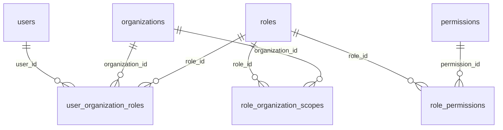
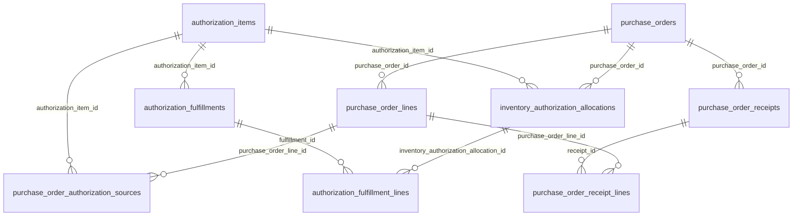
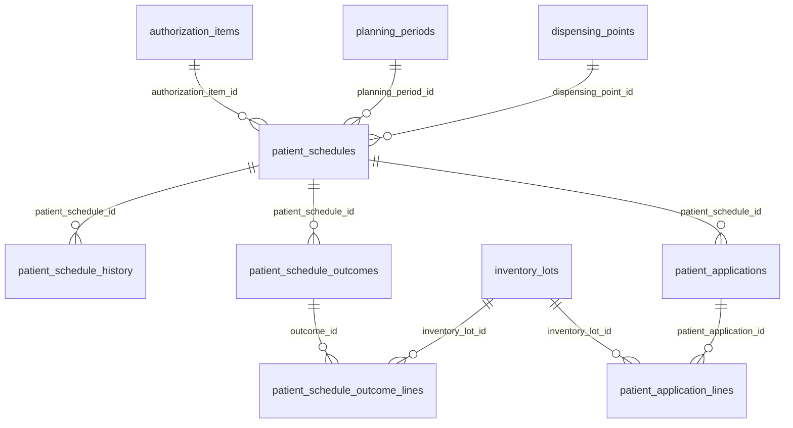
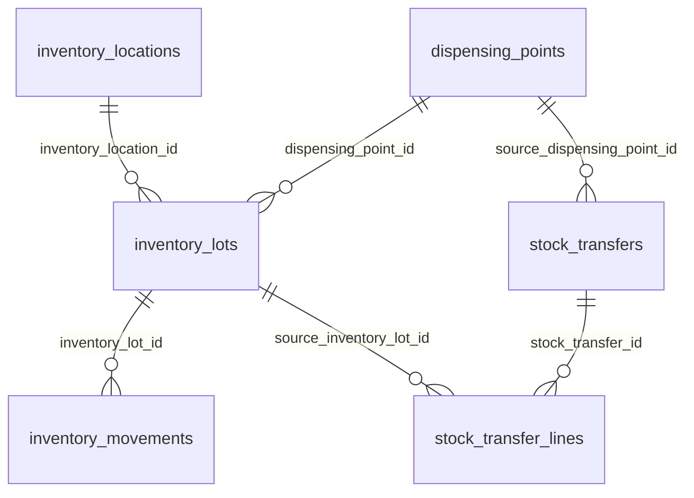

# Mapa de relaciones operativas principales

Este esquema es **orientativo** y muestra solo las relaciones verificadas en `packages/database/src/schema.ts` al commit `abdf411`. Los diagramas completos por dominio se generan con `node scripts/db-schema-catalog.mjs --generate`.

Las cardinalidades se presentan como lectura conceptual de FK, no como certificación de unicidad o cantidad mínima de registros. Algunos vínculos pueden ser opcionales y otros se derivan por lógica de negocio, sin una FK directa.

## 1. Identidad y permisos

**Lectura:** los permisos efectivos dependen de usuario, organización, rol y controles de ámbito de punto. Consultar `apps/api/src/identity/access.service.ts` y `packages/domain/src/organization-role-policy.ts`; una asignación SQL aislada no demuestra autorización operativa.

## 2. Autorización → OC → recepción → asignación → consumo

**Punto de control:** `purchase_order_authorization_sources` documenta el vínculo de compra; `purchase_order_receipt_lines` documenta cantidad efectivamente recibida por OC; `inventory_authorization_allocations` documenta reservas; `authorization_fulfillment_lines` documenta consumo/aplicación. No unir todo únicamente por código comercial ni sumar sin delimitar OC, punto y estado.

**Dos modelos de recepción coexisten:** `purchase_order_receipts`/`purchase_order_receipt_lines` (recepción directa de OC con cantidad) y `receipts`/`receipt_lines` (recepción asociada a entregas/lotes). No consolidarlos sin verificar el servicio correspondiente.

## 3. Programación, atención y novedades

**Lectura:** `patient_schedule_outcomes` incluye resultados de no aplicación; `patient_schedule_outcome_lines` registra unidades de productos no reutilizables vinculadas a un lote. La programación no equivale a movimiento físico.

## 4. Stock físico y traslados

`stock_transfers` también referencia el punto de destino. El stock confiable se deriva del libro de movimientos y de las restricciones operacionales; no debe suponerse que una OC aceptada ya está disponible.

## Regla de lectura para futuras auditorías

**Toda investigación debe registrar:** tabla y columnas, FK o vínculo lógico, proceso que crea/modifica, estado/autorización, cantidades y unidad, ambiente, SHA de código, prueba que verifica la regla y cualquier diferencia entre Drizzle y PostgreSQL real.
