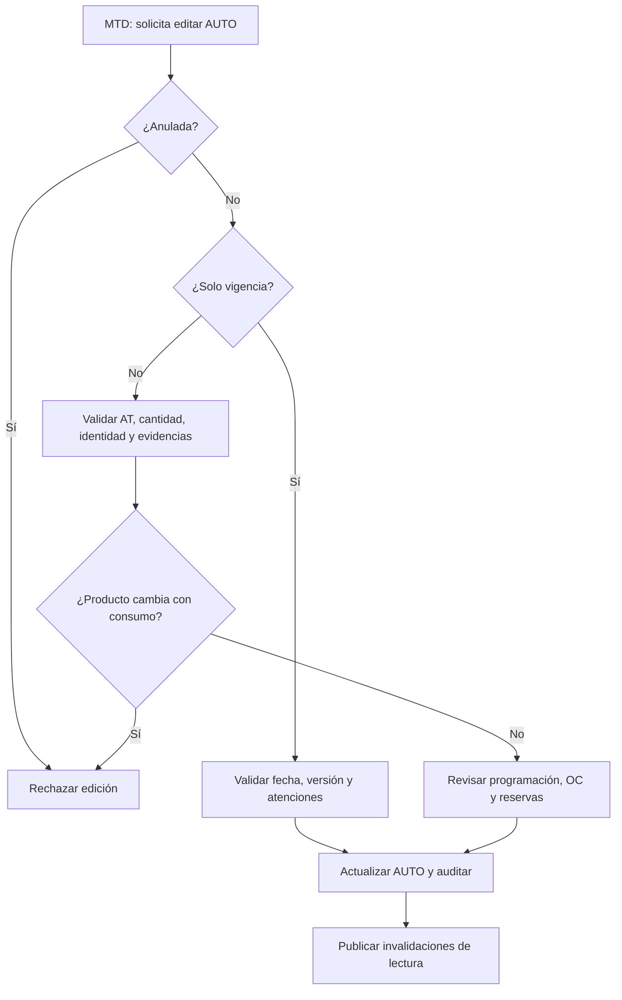

# Casos especiales y excepciones operativas

**Proyecto:** MTD – OLP – MEDICARTE. **Rama:** `develop` **SHA consultado:** `6b611d80d5fbe920d3464baaca9424eb6ad2f387` (17-10-2026). **Evidencia:** lectura estática del código remoto, no ejecución de API, bases ni worker. Los escenarios de prueba están **pendientes**, no aprobados.

Este índice complementa [el manual operativo](../manual-operativo.md) y [el catálogo general](../casos-de-uso.md); no reemplaza reglas históricas del [ADR-043](../adr/043-authorization-order-receipt-fulfillment-reassignment.md) ni los requerimientos aprobados.

| Sección | Documentación detallada | Quién interviene |
| --- | --- | --- |
| CE-01 a CE-07 | [Edición de vigencia, producto y cantidad](edicion-autorizaciones.md) | MTD; impacto OLP/MEDICARTE |
| CE-08 a CE-13 | [Reservas, vencimiento, anulación y liberación](liberaciones-reservas.md) | MTD; worker; inventario |
| CE-14 a CE-19 | [Auditoría de facturación individual y XLSX](auditoria-facturacion.md) | MTD |
| CE-20 a CE-25 | [Soportes de Drive, búsqueda y sincronización](soportes-drive.md) | MTD; worker; Drive |
| CE-26 a CE-32 | [Auditorías de atención y conciliación](auditorias-atencion-conciliacion.md) | MTD; MEDICARTE; control |
| Pruebas | [Matriz de escenarios negativos, históricos y concurrencia](matriz-pruebas-especiales.md) | QA / responsables |
| Cobertura | [Inventario de pendientes y límites de certificación](cobertura-pendiente.md) | Arquitectura / producto |

## Reglas de interpretación

1. **Persistido ≠ habilitado ≠ comprado ≠ recibido ≠ reservado ≠ consumido ≠ auditado.** Son registros y validaciones distintos.
2. **EXPIRED no provoca devolución automática.** El worker de vigencia solo invalida vistas en la política actual (ver CE-08).
3. Las mutaciones de autorización se ejecutan con `expectedVersion` para evitar sobrescrituras concurrentes.
4. Una edición **no** debe reescribir evidencia de OC donde OLP o MEDICARTE ya intervinieron.
5. La existencia de soporte **no** equivale a una auditoría aprobada; la ausencia de soporte **no** debe sustituir la decisión humana.
6. Un proceso documentado desde código se etiqueta **VERIFICADO EN FUENTE**; requiere prueba real y validación funcional para declararlo **CERTIFICADO**.

## Flujo de decisiones para casos especiales

**Fuentes representativas:** `apps/api/src/clinical/authorization-manual-edit.*`, `packages/domain/src/authorization-source-renewal.ts`, `apps/worker/src/inventory-expiration-release.ts`, `apps/api/src/audits/*`, `apps/worker/src/authorization-drive-support-sync.ts`, `packages/contracts/src/index.ts`.
