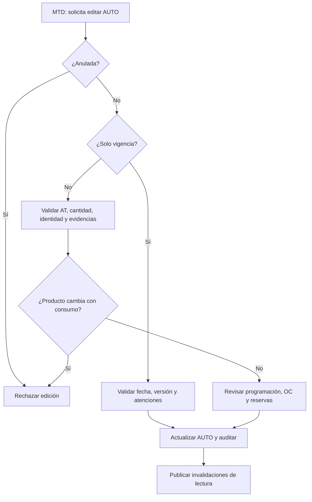

# Casos especiales y excepciones operativas

**Proyecto:** MTD – OLP – MEDICARTE. **Rama:** `develop` **SHA de revisión original:** `6b611d80d5fbe920d3464baaca9424eb6ad2f387`. **Ampliación verificada:** `97ade0b87f1a6e87730c89bf718169df41254155` (17-10-2026). **Evidencia:** lectura estática del código remoto, no ejecución de API, bases ni worker. Los escenarios de prueba están **pendientes**, no aprobados.

Este índice complementa [el manual operativo](../manual-operativo.md) y [el catálogo general](../casos-de-uso.md); no reemplaza reglas históricas del [ADR-043](../adr/043-authorization-order-receipt-fulfillment-reassignment.md) ni los requerimientos aprobados.

| Sección | Documentación detallada | Quién interviene |
| --- | --- | --- |
| CE-01 a CE-07 | [Edición de vigencia, producto y cantidad](edicion-autorizaciones.md) | MTD; impacto OLP/MEDICARTE |
| CE-08 a CE-13 | [Reservas, vencimiento, anulación y liberación](liberaciones-reservas.md) | MTD; worker; inventario |
| CE-14 a CE-19 | [Auditoría de facturación individual y XLSX](auditoria-facturacion.md) | MTD |
| CE-20 a CE-25 | [Soportes de Drive, búsqueda y sincronización](soportes-drive.md) | MTD; worker; Drive |
| CE-26 a CE-32 | [Auditorías de atención y conciliación](auditorias-atencion-conciliacion.md) | MTD; MEDICARTE; control |
| CE-33 a CE-40 | [MIPRES, PBS/NO PBS, errores y decisión manual](mipres-pbs-no-pbs.md) | MTD, MIPRES |
| CE-41 a CE-48 | [No asistencia y reprogramación, medicamento preparado](inasistencia-reprogramacion.md) | MEDICARTE, MTD |
| CE-49 a CE-56 | [Recepciones parciales, faltantes y lotes](recepciones-parciales-lotes.md) | MEDICARTE, OLP |
| CE-57 a CE-63 | [Traslados de existencias entre puntos](traslados-inventario.md) | MEDICARTE |
| CE-64 a CE-69 | [Devoluciones, daños, pérdidas y merma](devoluciones-mermas-productos.md) | MTD, MEDICARTE, OLP |
| CE-70 a CE-75 | [Precios, compensación y conciliación financiera](conciliacion-financiera-costos.md) | MTD, OLP, COMPENSAR |
| CE-76 a CE-84 | [RBAC, roles, organizaciones y puntos](permisos-rbac-casos-cruzados.md) | MTD, administración |
| RF-01 a RF-10 | [Brechas funcionales priorizadas](pendientes-funcionales-priorizados.md) | Arquitectura, producto, operaciones |
| Pruebas | [Matriz de escenarios negativos, históricos y concurrencia](matriz-pruebas-especiales.md) | QA / responsables |
| Cobertura | [Inventario de pendientes y límites de certificación](cobertura-pendiente.md) | Arquitectura / producto |

## Reglas de interpretación

1. **Persistido ≠ habilitado ≠ comprado ≠ recibido ≠ reservado ≠ consumido ≠ auditado.** Son registros y validaciones distintos.
2. **EXPIRED no provoca devolución automática.** El worker de vigencia solo invalida vistas en la política actual (ver CE-08).
3. Las mutaciones de autorización se ejecutan con `expectedVersion` para evitar sobrescrituras concurrentes.
4. Una edición **no** debe reescribir evidencia de OC donde OLP o MEDICARTE ya intervinieron.
5. La existencia de soporte **no** equivale a una auditoría aprobada; la ausencia de soporte **no** debe sustituir la decisión humana.
6. Un proceso documentado desde código se etiqueta **VERIFICADO EN FUENTE**; requiere prueba real y validación funcional para declararlo **CERTIFICADO**.

## Flujo de decisiones para casos especiales

**Fuentes representativas:** `apps/api/src/clinical/authorization-manual-edit.*`, `packages/domain/src/authorization-source-renewal.ts`, `apps/worker/src/inventory-expiration-release.ts`, `apps/api/src/audits/*`, `apps/worker/src/authorization-drive-support-sync.ts`, `packages/contracts/src/index.ts`.

## Cobertura ampliada (CE-33 a CE-84)

Esta segunda ampliación identifica **52 casos adicionales**; total acumulado **84 casos**. Los casos con etiqueta **REQUIERE DECISIÓN** son brechas, **no** módulos implantados. La matriz de pruebas se amplía a **97 casos por ejecutar**, sin resultados inventados.
