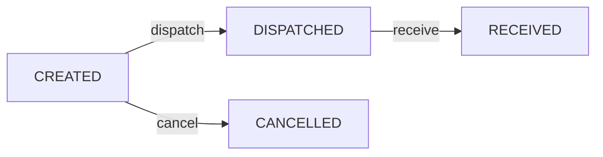

# Traslados entre puntos, trazabilidad de lote y restricciones

**Corte de evidencia:** `develop` commit `97ade0b87f1a6e87730c89bf718169df41254155` (17-10-2026). **Clasificación:** `IMPLEMENTADO EN FUENTE` = código observado, no funcionalidad probada; `SIN FLUJO VERIFICADO` = no se identificó una operación específica entre controladores/contratos revisados; `REQUIERE DECISIÓN` = propuesta, no regla aprobada. **No se ejecutaron pruebas ni se accedió a producción.**

## Máquina de estados

Los estados `RECEIVED` y `CANCELLED` son terminales para el flujo expuesto; no se observó un endpoint de retorno/reverso de traslado despachado en este controlador.

| ID | Caso | Regla de fuente | Estado |
| --- | --- | --- | --- |
| CE-57 | Crear traslado entre puntos | `POST /api/v1/inventory/transfers` con origen, destino y líneas `{sourceInventoryLotId, quantity}` | IMPLEMENTADO EN FUENTE |
| CE-58 | Corregir punto o cantidades | `PATCH /:id` solo mientras `CREATED`, con `expectedVersion` | IMPLEMENTADO EN FUENTE |
| CE-59 | Despachar lote vencido | Rechazo `STOCK_TRANSFER_EXPIRED_STOCK` | IMPLEMENTADO EN FUENTE |
| CE-60 | Despacho supera saldo o lote fuera de punto | Rechazo `STOCK_TRANSFER_INSUFFICIENT_BALANCE` o `STOCK_TRANSFER_LINE_OUT_OF_SCOPE`; movimiento de salida solo cuando es válido | IMPLEMENTADO EN FUENTE |
| CE-61 | Recibir en destino | Requiere `DISPATCHED`; movimiento de entrada en lote destino identificado por producto+lote+vencimiento+punto y ubicación compatible | IMPLEMENTADO EN FUENTE |
| CE-62 | Cancelar después de despachar | Rechazo `STOCK_TRANSFER_CANCEL_NOT_ALLOWED`; cancelación permitida solo desde `CREATED` | IMPLEMENTADO EN FUENTE |
| CE-63 | Recibir parcialmente, reportar pérdida en tránsito o devolver traslado | No se identificó operación específica en los endpoints `create/update/dispatch/receive/cancel` | SIN FLUJO VERIFICADO / REQUIERE DECISIÓN |

## Procedimiento y controles

1. Antes de crear, validar saldo por lote en el origen, vigencia y acceso efectivo al punto.
2. Documentar evidencia de salida y número de unidades por lote; ejecutar `dispatch` una sola vez sobre la versión más reciente.
3. Al arribo, comprobar sello, unidades y lote; solo ejecutar `receive` si el despacho corresponde exactamente a lo recibido y la ubicación de destino es válida.
4. Si hay faltantes o daño **no confirmar recepción total para ocultar la novedad**. Escalar incidencia de transporte y definir manejo por proceso separado; no existe en el controlador un `receive partial` explícito.
5. Corroborar movimientos origen/destino y auditoría: `STOCK_TRANSFER_UPDATED`, `DISPATCHED`, `RECEIVED` o `CANCELLED`.

**Código verificado:** `apps/api/src/inventory/stock-transfer.{controller,repository}.ts`, `packages/contracts/src/index.ts`, `packages/database/migrations/0044_esp009_stock_transfers.sql`.
