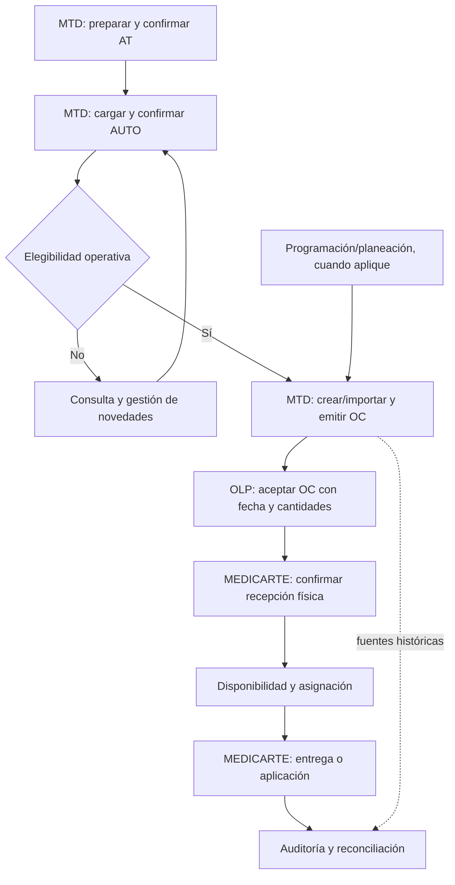

# Manual operativo — MTD, OLP y MEDICARTE

**Rama de referencia:** `develop` · **Corte de código:** `7ced5792c08faf35e673e2f1c2ca4571892ab87a` · **Fecha:** 2026-10-17.

## Propósito y límites

Este índice reúne flujos de trabajo y casos de uso verificados por **inspección estática** de controladores, contratos, servicios y pantallas. No es una certificación de operación en producción. El nombre comercial de la aplicación no está definido en el repositorio. Se usa **AUTO** para un ítem de autorización; **OC** para orden de compra y **AT** para Anexo Tarifario.

**Regla de lectura:** `IMPLEMENTADO EN CÓDIGO` indica que hay ruta y lógica comprobables; `DECISIÓN` indica negocio formalizado en ADR/requerimiento; `POR CERTIFICAR` exige pruebas HTTP/integración y validación operacional antes de afirmar que el flujo funciona completamente.

## Documentos de ejecución

| Actor o ámbito | Guía | Propósito |
| --- | --- | --- |
| MTD | [Flujo MTD](flujo-mtd.md) | AT, cargue de AUTO, validación, importación de OC, asignación y anulaciones |
| OLP | [Flujo OLP](flujo-olp.md) | Revisión, aceptación, compromiso, costos OLP y logística |
| MEDICARTE | [Flujo MEDICARTE](flujo-medicarte.md) | Recepción física, programación, entrega y aplicación |
| Transversal | [Catálogo de casos de uso](casos-de-uso.md) | Entradas, precondiciones, salidas, excepciones, rutas y permisos |
| Aseguramiento | [Matriz de pruebas](matriz-pruebas-operativas.md) | Casos positivos, negativos, concurrencia y evidencias mínimas |

## Excepciones operativas

Ver el [índice de casos especiales](casos-especiales/README.md): edición de vigencia/producto/cantidad, política de no liberación por vencimiento, anulación, soportes Google Drive, auditorías de facturación, auditorías de atención y reconciliación. Estas reglas complementan, pero no sustituyen, el flujo normal de MTD, OLP y MEDICARTE.

## Flujo extremo a extremo

> El diagrama describe el **recorrido operativo principal**, no un bloqueo secuencial universal. El sistema admite creación directa de OC desde autorizaciones y OC por demanda consolidada. Registrar una AUTO no requiere que ya esté operativamente elegible.

## Tabla de responsabilidad y entrega entre actores

| Hito | Responsable | Entrada principal | Evidencia/salida | Siguiente actor |
| --- | --- | --- | --- | --- |
| Catálogo contractual | MTD | Archivo AT | PREPARE, preview, CONFIRM; productos/revisiones | MTD |
| Autorización | MTD | XLSX con identidad AUTO/producto | Trabajo de importación, filas y resultados | MTD / MEDICARTE consulta |
| Planeación de atención | MEDICARTE y proceso de planeación según permisos | Fecha, punto, programación | Registros operativos, demanda si aplica | MTD |
| Compromiso de compra | MTD | AUTO/OC/producto/cantidad o demanda consolidada | OC emitida, fuentes históricas | OLP |
| Compromiso de proveedor | OLP | OC emitida | Aceptación, fecha comprometida y gestión de cantidades | MEDICARTE |
| Recepción física | MEDICARTE | OC aceptada y cantidades recibidas | Recepción por línea; saldo pendiente | MEDICARTE |
| Atención paciente | MEDICARTE | AUTO elegible, OC compatible y cantidad efectivamente recibida | Entrega/aplicación confirmada | Auditoría |
| Conciliación y control | Roles habilitados | Registros OC/recepción/consumo y evidencias | Hallazgos, issues, decisiones | Responsables asignados |

La matriz expresa la **responsabilidad conceptual**. La habilitación concreta siempre se determina mediante permisos RBAC y organización del usuario (no solo el nombre del actor), con restricciones adicionales por punto.

## Invariantes mínimos

- AUTO persistida ≠ AUTO habilitada para atención/compra.
- OC emitida/aceptada ≠ medicamento recibido.
- `recibido acumulado` y `consumido` se miden por producto, OC y contexto operacional válido, sin duplicar entradas; el consumo no debe superar el disponible.
- Una OC conserva relación histórica con la(s) AUTO que sustentaron la compra aunque se actualice su estado vivo o se anule una AUTO.
- Reasignar reserva no revierte una entrega/aplicación ya realizada.
- Habilitación, vigencia, estado de asignación y progreso de atención son **estados diferentes**.
- API aplica aislamiento de organización, permisos y ámbito de puntos; SSE solo invalida lectura y no constituye una escritura clínica.

Véase [arquitectura](architecture-current.md), [ADR-043](adr/043-authorization-order-receipt-fulfillment-reassignment.md) y [ADR-044](adr/044-realtime-operational-invalidation.md). El enlace canónico de ADR-043 es `docs/adr/043-authorization-order-receipt-fulfillment-reassignment.md`.

## Entradas y navegación observables en la web

| Proceso | Ruta web verificada |
| --- | --- |
| Cargue de autorizaciones | `/autorizaciones` |
| Consulta/atención de autorizaciones | `/autorizaciones/consulta` |
| Configuración y cargue de AT | `/ordenes-compra/configuracion` |
| OC MTD/OLP | `/ordenes-compra` |
| Detalle operacional OC | `/ordenes-compra/[id]` |
| Recepciones | `/recepciones` |
| Programación | `/programacion` |
| Planeación | `/periodos` |
| Demanda | `/demanda` |
| Disponibilidad | `/inventario/disponibilidad` |
| Auditorías | `/auditorias` |

`/importaciones` redirige a `/autorizaciones` y `/logistica-olp` a `/ordenes-compra` en el árbol consultado. La visibilidad del módulo en cada sesión depende de permisos y perfil.

## Aspectos por certificar con operación real

1. Concordancia entre accesos del menú, permisos, pantallas y procesos autorizados por MTD/OLP/MEDICARTE.
2. OC emitidas por carga directa versus OC de demanda y sus restricciones de estados/fechas.
3. Conciliación entre recibos `quantity-only`, asignaciones, saldo por OC/punto y cumplimiento de la regla **nunca consumir más de lo recibido**.
4. Comportamiento con recepciones repetidas/parciales, stock insuficiente, anulaciones y concurrencia.
5. Correspondencia del catálogo de excepciones con mensajes mostrados al usuario final.
6. Integración MIPRES/Drive y política de auditoría/facturación bajo credenciales de prueba.
